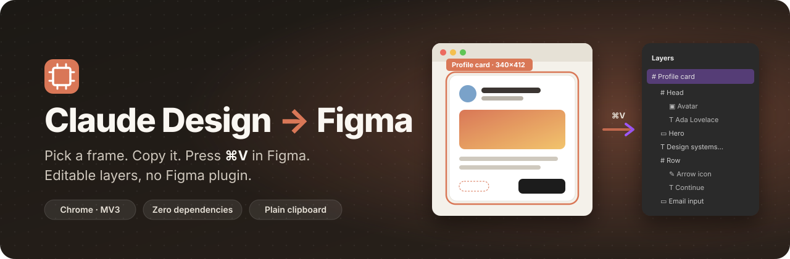
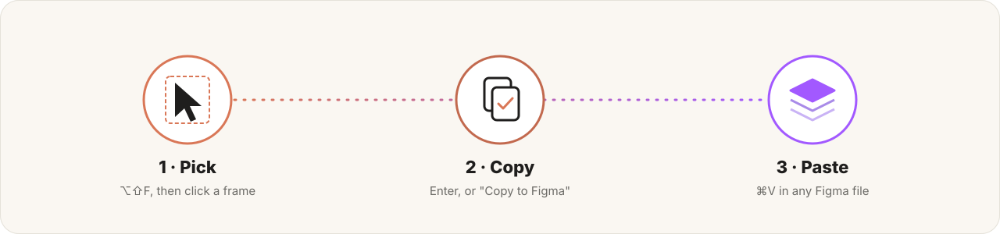

<p align="center">
  
</p>

<p align="center">
  <b>A Chrome extension that copies any frame from Claude Design and pastes it into Figma as real, editable layers.</b><br>
  No Figma plugin, no export files, no screenshots. Just the clipboard.
</p>

<p align="center">
  
  
  
  
</p>

<p align="center">
  <a href="#-install">Install</a> ·
  <a href="#-use">Use</a> ·
  <a href="#-what-comes-across">What comes across</a> ·
  <a href="#-how-it-works">How it works</a> ·
  <a href="#-development">Development</a>
</p>

---

## ✨ Why

You've built a screen in Claude Design and want it in Figma, where your team works. Screenshots give you a flat image, and rebuilding by hand takes hours.

**C2F turns the frame you pick into a layered Figma frame in about a second.** Text stays as text, boxes stay as boxes, and the layers keep their names.

<p align="center">
  
</p>

## 🧩 Features

| | |
|---|---|
| 🎯 **Frame picker** | Hover to see each frame outlined with its name and size. Click it, and you're ready to copy. |
| 🖼️ **Whole frame in one key** | `Shift+↑` jumps straight to the full artboard, even when you clicked a small element inside it. |
| 🪆 **Nested content included** | Frames whose content is rendered inside an embedded design iframe are copied with all their children. |
| 📜 **Scrolled content included** | Scrolling areas are unrolled while copying, so items out of view come along. The page is put back exactly as it was. |
| 🔍 **Zoom-proof** | Sizes are normalised to 1×, so a zoomed-in or zoomed-out canvas still pastes at real size. |
| 📋 **Three ways to copy** | Use the on-page picker, the popup's frame list, or right-click → **Copy this frame to Figma**. |
| 🔌 **Plugin-free** | The extension writes Figma-friendly SVG to the clipboard, and Figma's own paste turns it into layers. |

## 🎨 What comes across

| In Claude Design | In Figma |
|---|---|
| Text, with font, weight, size, line height, letter spacing and colour | **Text layers** you can edit |
| Boxes with backgrounds, borders and rounded corners | **Rectangles** with fills, strokes and radii |
| Linear and radial gradients | **Gradient fills** |
| `box-shadow` (outer and inset) | **Drop shadow / inner shadow** effects |
| `` and CSS background images | **Image fills**, embedded |
| Inline SVG icons | **Vector layers** |
| `overflow: hidden` containers | **Clipped groups** |
| `aria-label`, `data-name`, ids and classes | **Layer names** |

> [!NOTE]
> Layers are positioned absolutely. Auto-layout, `::before`/`::after` content, CSS rotation, blend modes, filters and cross-origin iframes aren't captured yet. Figma uses the fonts you have installed and substitutes any that are missing.

## 📦 Install

1. Download or clone this repository.
   ```bash
   git clone https://github.com/ashiq-kodali/cluade2figma.git
   ```
2. Open `chrome://extensions` and turn on **Developer mode** (top right).
3. Click **Load unpacked** and choose the `extension/` folder.
4. Pin **Claude Design → Figma** to your toolbar.
5. Reload any Claude tabs that were already open. If you skip this, the extension injects itself the first time you use it.

## 🚀 Use

1. Open a design on **claude.ai**.
2. Press <kbd>⌥</kbd> <kbd>⇧</kbd> <kbd>F</kbd> (<kbd>Alt</kbd> <kbd>Shift</kbd> <kbd>F</kbd> on Windows), or click **Pick a frame on the page** in the popup.
3. Hover to see frames outlined, then click inside the one you want.
4. Press **Whole frame** (<kbd>Shift</kbd> <kbd>↑</kbd>) until the outline covers the full frame.
5. Press **Copy to Figma** (<kbd>Enter</kbd>).
6. Switch to Figma and press <kbd>⌘</kbd> <kbd>V</kbd>.

### Picker shortcuts

| Key | Action |
|---|---|
| <kbd>Shift</kbd> <kbd>↑</kbd> | Select the whole frame (press again to step out of an embedded frame) |
| <kbd>↑</kbd> / <kbd>↓</kbd> | Move to the parent / child element |
| <kbd>Enter</kbd> | Copy the selection |
| <kbd>Esc</kbd> | Cancel |

### Other ways to copy

- **Popup list.** Click the toolbar icon to see the frames found on the page. Hover a row to highlight that frame, then click **Copy**.
- **Right-click.** Right-click inside a frame and choose **Copy this frame to Figma**.

## ⚙️ How it works

```
 Claude Design page                         Chrome extension                         Figma
┌──────────────────┐   pick    ┌──────────────────────────────────────┐   ⌘V   ┌──────────────┐
│  frame (DOM)     │ ────────▶ │ serialize.js  DOM → layer tree       │ ─────▶ │ editable     │
│  ├─ text         │           │ to-svg.js     layer tree → SVG       │        │ layers       │
│  ├─ boxes        │           │ background.js SVG → clipboard        │        │              │
│  └─ iframe ──────┼─ message ▶│ (child frames serialize themselves)  │        │              │
└──────────────────┘           └──────────────────────────────────────┘        └──────────────┘
```

1. **Serialize.** The picked element is walked with `getComputedStyle` and `getBoundingClientRect` into a layer tree. The tree records fills, borders, radii, shadows, text runs measured line by line, images and vectors. Scrolling areas are unrolled first and restored afterwards.
2. **Embedded frames.** When the walk reaches an iframe, it asks the content script inside it, over `postMessage`, to serialize its own viewport. The reply is nested in place as child layers.
3. **Write SVG.** The tree becomes SVG in the shape Figma's importer understands: named `<g>` groups, `<text>`/`<tspan>` text, pattern image fills, Figma-style shadow filters and `clipPath`s.
4. **Clipboard.** The background worker writes the SVG through an offscreen document, because design iframes are sandboxed and can't use `navigator.clipboard` themselves.

## 🗂️ Project layout

```
extension/
  manifest.json      MV3 manifest: shortcut, context menu, Claude hosts
  background.js      shortcut, context menu, clipboard via offscreen document
  offscreen.html/js  writes text to the clipboard
  content/
    ns.js            shared C2F namespace
    serialize.js     DOM → layer tree (scroll unrolling, iframe embedding)
    to-svg.js        layer tree → Figma-friendly SVG
    frames.js        frame detection
    picker.js        on-page picker UI and toolbar
  popup/             toolbar popup with frame list
  lib/image.js       image fetching and conversion
  icons/
dev/
  fixture.html       local test page (cards, zoom, scrolling list, iframe)
  frame.html         page embedded by the fixture's iframe
  serve.py           no-cache static server
docs/                README graphics
```

## 🛠️ Development

No build step. Edit the files, then click **Reload** on the extension in `chrome://extensions`.

To test the serializer without Claude, run the local fixture page:

```bash
python3 dev/serve.py 5179
```

Open <http://localhost:5179/dev/fixture.html> and run `__runAll()` in the console. It copies every test card and shows the generated SVG under the page for side-by-side comparison.

## 🔒 Privacy

Everything happens in your browser. The extension runs only on Claude pages (`claude.ai`, `claudeusercontent.com`, `claude.site`), makes no network calls of its own apart from loading images already on the page, and stores nothing.

---

<p align="center">
  <sub>An independent project, not affiliated with Anthropic or Figma.</sub>
</p>
